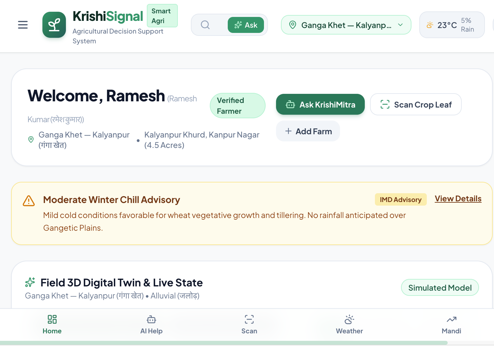

# 🌾 KrishiSignal — AI-Powered Smart Farming & Agricultural Decision Support Platform



> **Empowering Indian Farmers with Grounded Agronomic Intelligence, Real-time Meteorological Feeds, Verified Mandi Prices, and Interactive 3D Digital Twins.**

[](https://github.com)
[](https://react.dev)
[](https://www.typescriptlang.org)
[](https://tailwindcss.com)
[](https://threejs.org)
[](https://ai.google.dev)
[](https://open-meteo.com)
[](https://agmarknet.gov.in)

---

## 📸 Platform Interface Preview

Here is the live interface of KrishiSignal featuring the authenticated farmer dashboard, instant agricultural weather warnings, micro-climate sensor telemetry, and 3D digital twin:

<p align="center">
  
</p>

---

## 🌟 Key Features & Architecture

### 1. 🌾 Interactive 3D Farm Digital Twin (`Three.js / WebGL`)
- **Topographical Field Simulation**: Simulates field furrows, undulating agricultural soil contours, and realistic wheat/mustard crops with wind sway dynamics.
- **Micro-Climate Atmospheric Rendering**: Real-time atmospheric shader synchronization: bright direct sunlight with floating pollen particles vs. active rain particle systems during precipitation events.
- **Root-Zone Telemetry Overlay**: Visual, Soil Moisture (Thermal), and Bird's-Eye camera perspective modes.
- **3D Plant Anatomy Inspector**: Rotational 3D plant node viewer enabling farmers to examine root proliferation, tillers, and yellow rust spore pustules.

### 2. 🌦️ Grounded Meteorological Advisories (`Open-Meteo & IMD`)
- **District-Wise Real-Time Weather**: Observation times, hourly temperature curves, humidity, and 5-day rainfall probability for Uttar Pradesh districts (Kanpur, Lucknow, Varanasi, Prayagraj, etc.).
- **Spray Feasibility Index**: Evaluates wind velocity (< 12 km/h) and droplet drift risk to recommend safe chemical and foliar nutrient spraying windows.
- **Automated Weather Alerts**: Frost warnings, high wind alerts, and precipitation advisories.

### 3. 💧 Explainable Irrigation Decision Support System (DSS)
- **Zero Hallucination Deterministic Engine**: Cross-references crop phenological stage (Crown Root Initiation, Tillering, Jointing, Flowering, Milk Stage), 72-hour forecast rainfall, and soil water retention.
- **Explainable Recommendation**: Explains *why* an irrigation should be performed or delayed (e.g. holding irrigation if rain > 15mm is anticipated in 48h to prevent urea leaching).

### 4. 📈 AGMARKNET Mandi Intelligence & Net Realization Calculator
- **Daily Modal Prices**: Live market price feeds across UP APMC mandis (Kanpur Naubasta, Lucknow Dubagga, Barabanki, Varanasi Pahariya).
- **Net Farmer Take-Home Calculator**: Deducts transport/freight cartage and APMC market cess from gross value to determine actual in-hand proceeds.

### 5. 🤖 KrishiMitra Voice AI Assistant (`Google Gemini 2.5 Flash`)
- **Bilingual Conversational Interface**: Grounded agricultural reasoning in English and Hindi with verified ICAR source citations.
- **Web Speech API Audio**: Hands-free in-browser Speech-to-Text and Text-to-Speech audio read-aloud for seamless field use.
- **Foliar Disease Screening**: Computer vision inspection for Yellow Rust, Leaf Blight, and Aphids, pairing organic Neem sprays with certified chemical fungicides.

### 6. 🗺️ Geospatial GIS Mapping & Farm Diary
- **Interactive Leaflet & OpenStreetMap**: Maps registered farm boundaries, nearby APMC mandis, and Krishi Vigyan Kendras (KVKs).
- **Farm Activity Diary & Expense Ledger**: Daily operation tracking with seasonal profit and loss statements.
- **Government Schemes Directory**: Direct links and eligibility checklists for PM-KISAN, PMFBY crop insurance, and Soil Health Card.

---

## 🛠️ Technology Stack

| Domain | Technology |
|---|---|
| **Frontend Framework** | React 19, TypeScript, Vite |
| **Styling & Theme** | Tailwind CSS v4, Lucide Icons, Modern Clean Contrast |
| **3D Graphics & Simulation** | Three.js (WebGL 3D Digital Twin & Anatomy Inspector) |
| **GIS Mapping** | Leaflet, OpenStreetMap |
| **Artificial Intelligence** | Google Gemini API (`@google/genai` TypeScript SDK), Gemini 2.5 Flash |
| **Speech & Audio** | Browser Native Web Speech API (SpeechRecognition & SpeechSynthesis) |
| **Data Feeds** | Open-Meteo Global Agrometeorological API, AGMARKNET Mandi Datasets |
| **State & Persistence** | React Context API, LocalStorage Caching |

---

## 🚀 Quickstart & Local Installation

### Prerequisites
- Node.js 18+ or 20+
- npm or pnpm

### Installation Steps

```bash
# 1. Clone the repository
git clone https://github.com/your-username/krishisignal.git
cd krishisignal

# 2. Install all dependencies
npm install

# 3. Configure environment variables (optional for AI features)
cp .env.example .env

# 4. Start the local development server
npm run dev
```

Open your browser and navigate to `http://localhost:3000`.

---

## 🔐 Environment Configuration

Create a `.env` file in the root directory (refer to `.env.example`):

```env
# Gemini API Key for KrishiMitra AI Assistant
GEMINI_API_KEY="YOUR_GEMINI_API_KEY"

# Application URL
APP_URL="http://localhost:3000"

# Weather & Open-Meteo Base URL
WEATHER_API_BASE_URL="https://api.open-meteo.com/v1"
```

---

## 📄 Scientific Agronomic Disclaimer

KrishiSignal is developed for educational and agricultural decision support. All irrigation, fertilizer, and disease advisories generated by KrishiSignal are decision-support estimates derived from ICAR guidelines, IMD weather models, and Agmarknet data. Always adhere to recommended pesticide label waiting periods (PHI) and verify local conditions with your Block Agricultural Extension Officer or nearest Krishi Vigyan Kendra (KVK).

---

<p align="center">
  <b>KrishiSignal — AI-Powered Smart Farming Platform</b><br />
  Designed for Farmers in Uttar Pradesh, India
</p>
